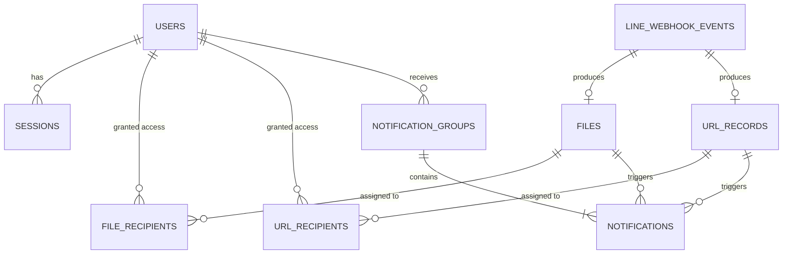

# การออกแบบฐานข้อมูล (DATABASE SCHEMA)

ระบบใช้ฐานข้อมูล **SQLite 3** ในโหมด **WAL (Write-Ahead Logging)** พร้อมเปิดใช้งาน `PRAGMA foreign_keys = ON` เพื่อบังคับความถูกต้องของความสัมพันธ์ข้อมูลทั้งหมด

---

## 1. แผนผังความสัมพันธ์ข้อมูล (ER Diagram)

---

## 2. รายละเอียดตารางทั้งหมด (Table Definitions)

### 2.1 ตาราง `users` (ข้อมูลผู้ใช้งานและผู้ดูแลระบบ)
เก็บข้อมูลบัญชีทั้ง `USER` และ `ADMIN` (REQ-05, REQ-06)
- `id` (`INTEGER PRIMARY KEY AUTOINCREMENT`)
- `user_id` (`TEXT NOT NULL UNIQUE`) — รหัสผู้ใช้งาน เช่น `6501001` หรือ `admin`
- `full_name` (`TEXT NOT NULL`) — ชื่อ-นามสกุล
- `password_hash` (`TEXT NOT NULL`) — รหัสผ่านที่เข้ารหัสด้วย Argon2id
- `role` (`TEXT NOT NULL CHECK (role IN ('USER', 'ADMIN'))`)
- `status` (`TEXT NOT NULL CHECK (status IN ('ACTIVE', 'INACTIVE', 'SUSPENDED'))`)
- `must_change_password` (`INTEGER NOT NULL DEFAULT 1`) — `1` = บังคับเปลี่ยนรหัสผ่านเมื่อ Login ครั้งแรก
- `failed_login_attempts` (`INTEGER NOT NULL DEFAULT 0`) — จำนวนครั้งที่กรอกรหัสผ่านผิดติดต่อกัน
- `locked_until` (`TEXT DEFAULT NULL`) — เวลาปลดล็อกกรณีเดารหัสผ่านผิดเกินกำหนด
- `created_at`, `updated_at` (`TEXT NOT NULL`)

### 2.2 ตาราง `sessions` (จัดการ Session ของผู้ใช้งาน)
- `session_id` (`TEXT PRIMARY KEY`)
- `user_pk` (`INTEGER NOT NULL REFERENCES users(id) ON DELETE CASCADE`)
- `csrf_token` (`TEXT NOT NULL`) — Token สำหรับป้องกัน CSRF
- `ip_address`, `user_agent` (`TEXT`)
- `expires_at`, `created_at` (`TEXT NOT NULL`)

### 2.3 ตาราง `line_webhook_events` (ประวัติและสถานะการประมวลผล LINE Webhook)
- `id` (`INTEGER PRIMARY KEY AUTOINCREMENT`)
- `webhook_event_id` (`TEXT NOT NULL UNIQUE`) — รหัส Event จาก LINE สำหรับป้องกันการทำงานซ้ำ (Idempotency)
- `line_message_id` (`TEXT UNIQUE`) — Message ID ของข้อความหรือไฟล์
- `quote_token`, `quoted_message_id`, `image_set_id` (`TEXT`)
- `sender_line_user_id` (`TEXT NOT NULL`) — LINE `userId` ของผู้ส่ง
- `source_type` (`TEXT NOT NULL`) — เช่น `user`
- `event_type`, `message_type` (`TEXT`) — เช่น `file`, `image`, `video`, `audio`, `text`
- `raw_payload` (`TEXT NOT NULL`) — JSON ต้นฉบับ
- `processing_status` (`TEXT NOT NULL`) — สถานะ `RECEIVED`, `VALIDATING`, `DOWNLOADING`, `STORING`, `DATABASE_COMMITTED`, `SUCCESS`, `FAILED`
- `is_redelivery` (`INTEGER NOT NULL DEFAULT 0`)
- `reply_status` (`TEXT NOT NULL`) — `PENDING`, `SENT`, `EXPIRED`, `FAILED`, `NOT_APPLICABLE`
- `error_message`, `received_at`, `completed_at` (`TEXT`)

### 2.4 ตาราง `files` (ข้อมูลไฟล์และ Metadata)
- `id` (`INTEGER PRIMARY KEY AUTOINCREMENT`)
- `file_uuid` (`TEXT NOT NULL UNIQUE`) — UUID สำหรับอ้างอิงใน API และตั้งเป็นชื่อไฟล์จริงบน Disk
- `webhook_event_pk` (`INTEGER REFERENCES line_webhook_events(id) ON DELETE SET NULL`)
- `line_message_id` (`TEXT UNIQUE`)
- `original_name` (`TEXT NOT NULL`) — ชื่อไฟล์ต้นฉบับสำหรับแสดงให้ผู้ใช้เห็น
- `stored_filename` (`TEXT NOT NULL`) — ชื่อไฟล์จริงบน Disk (`{file_uuid}.{ext}`)
- `relative_storage_path` (`TEXT NOT NULL`) — Path สัมพัทธ์ภายใน `storage/`
- `mime_type`, `file_extension` (`TEXT NOT NULL`)
- `file_category` (`TEXT NOT NULL`) — `PDF`, `IMAGE`, `DOCUMENT`, `VIDEO`, `AUDIO`, `ARCHIVE`, `OTHER`
- `file_size_bytes` (`INTEGER NOT NULL`)
- `sha256_checksum` (`TEXT NOT NULL`) — ค่าแฮชตรวจสอบความสมบูรณ์ของไฟล์
- `attached_message`, `recipient_raw_text` (`TEXT`)
- `visibility` (`TEXT NOT NULL CHECK (visibility IN ('PRIVATE', 'PUBLIC'))`)
- `is_previewable` (`INTEGER NOT NULL DEFAULT 0`) — `1` เฉพาะไฟล์ PDF และรูปภาพที่รองรับ Preview
- `status` (`TEXT NOT NULL DEFAULT 'ACTIVE' CHECK (status IN ('ACTIVE', 'DELETED'))`)
- `received_at`, `created_at` (`TEXT NOT NULL`)

### 2.5 ตาราง `file_recipients` (สิทธิ์ผู้รับไฟล์ส่วนตัว)
- `id` (`INTEGER PRIMARY KEY AUTOINCREMENT`)
- `file_pk` (`INTEGER NOT NULL REFERENCES files(id) ON DELETE CASCADE`)
- `user_pk` (`INTEGER REFERENCES users(id) ON DELETE SET NULL`) — ใช้ `ON DELETE SET NULL` เพื่อรักษาไฟล์ไว้แม้ Admin จะลบบัญชี User ออกไปแล้ว (REQ-05)
- `recipient_user_id` (`TEXT NOT NULL`) — เก็บรหัส `user_id` คู่ไว้เสมอ
- `assigned_at` (`TEXT NOT NULL`)
- `UNIQUE(file_pk, recipient_user_id)`

### 2.6 ตาราง `url_records` และ `url_recipients` (ข้อมูลลิงก์ URL - REQ-14)
- เก็บลิงก์ URL (`url`), ข้อความแนบ (`attached_message`), พื้นที่ (`PRIVATE` / `PUBLIC`), เวลาที่ได้รับ (`received_at`) และตารางเชื่อมผู้รับ (`url_recipients`) โดยไม่มีการดาวน์โหลดเนื้อหาจาก URL มาเก็บเป็นไฟล์ Binary

### 2.7 ตาราง `notification_groups` และ `notifications` (ระบบแจ้งเตือนและการจัดกลุ่ม - REQ-17, REQ-18)
- `notification_groups`: เก็บกลุ่มการแจ้งเตือนตามผู้รับ (`user_pk`), ประเภท (`visibility_scope`), คีย์การจัดกลุ่ม (`batch_key`), จำนวนไฟล์ในกลุ่ม (`item_count`), สถานะการอ่าน (`is_read`) และช่วงเวลา (`first_received_at`, `last_received_at`)
- `notifications`: เก็บรายการแจ้งเตือนย่อยของแต่ละไฟล์หรือ URL ภายในกลุ่ม

### 2.8 ตาราง `backup_logs` และ `system_logs` (ประวัติการสำรองข้อมูลและบันทึกการทำงาน)
- `backup_logs`: เก็บ `backup_id`, `backup_type` (`SCHEDULED_6H` | `MANUAL`), `target_path`, `status` (`RUNNING` | `SUCCESS` | `FAILED` | `RESTORED`), ขนาดฐานข้อมูล, จำนวนไฟล์, ค่า `manifest_sha256` และเวลาเริ่มต้น/เสร็จสิ้น
- `system_logs`: เก็บ `level` (`INFO` | `WARN` | `ERROR` | `SECURITY`), `category`, `action`, `actor_user_id`, `ip_address`, `details_json`, `created_at`

