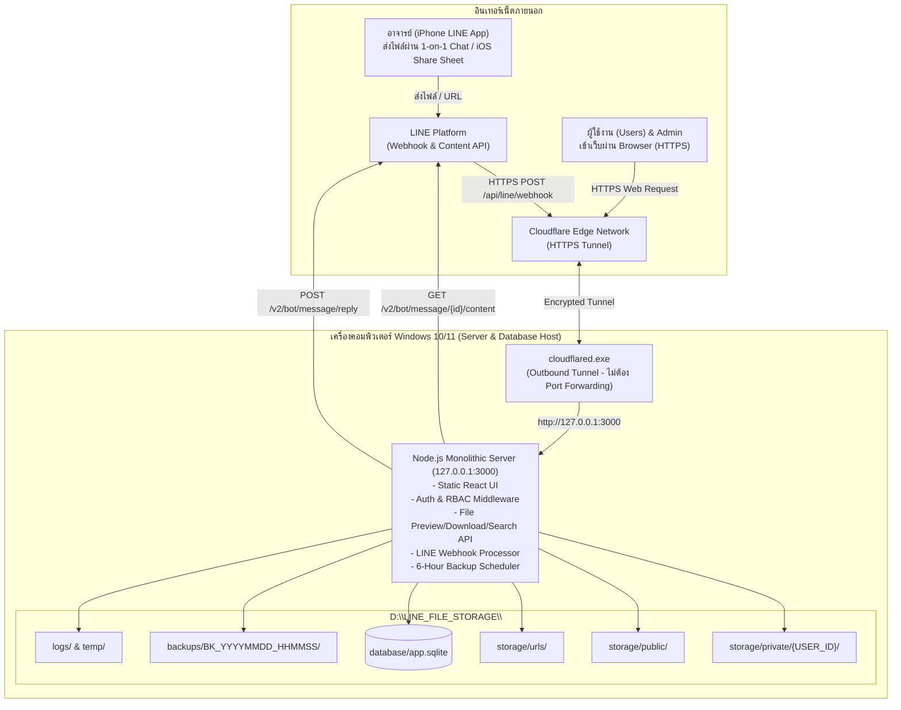
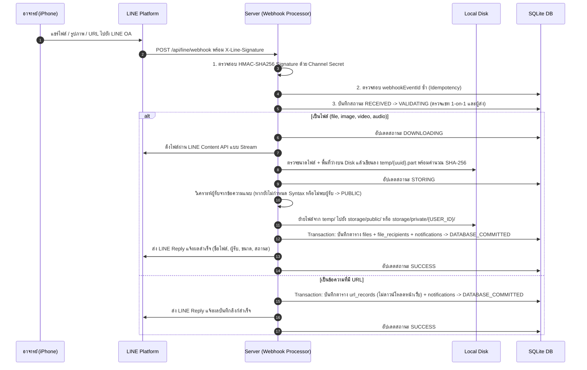

# สถาปัตยกรรมระบบ (SYSTEM ARCHITECTURE)

เอกสารนี้อธิบายสถาปัตยกรรมของระบบ การเลือกใช้เทคโนโลยี และแผนผังการไหลของข้อมูลในทุกส่วนสำคัญของระบบ

---

## 1. เหตุผลในการเลือก Tech Stack (REQ-11)

- **Node.js (v22.5+ / v24 LTS) + TypeScript + Express:**
  - ทำงานแบบ Native บน Windows 10/11 โดยไม่ต้องรัน Virtual Machine หรือ Docker Desktop ที่กินหน่วยความจำสูง
  - ใช้หน่วยความจำ (RAM) ต่ำมาก (~50–80 MB ขณะพัก) เหมาะกับการเปิดทำงานต่อเนื่อง 24/7 บนคอมพิวเตอร์ส่วนตัว
  - รองรับการดาวน์โหลดไฟล์จาก LINE Content API แบบ **Stream Pipeline** ลงสู่ Disk โดยตรงพร้อมตรวจสอบขนาดไฟล์และพื้นที่ว่างแบบ Real-time
  - รวมการให้บริการทั้ง Backend API (`/api/*`), LINE Webhook (`/api/line/webhook`) และหน้าเว็บ Frontend ไว้ในพอร์ตเดียวกัน (`127.0.0.1:3000`) ทำให้เชื่อมต่อผ่าน Cloudflare Tunnel เพียงช่องทางเดียวได้ทันที
- **SQLite (`node:sqlite` โหมด WAL - Write-Ahead Logging):**
  - เป็น Relational Database จริงที่รองรับ ACID Transaction, Primary Key, Foreign Key, Unique Constraint และ Index
  - **ปลอดภัยสูงสุด:** ไม่มีพอร์ตฐานข้อมูลเปิดออกสู่เครือข่าย (Embedded Database) จึงไม่มีความเสี่ยงที่ฐานข้อมูลจะถูกโจมตีผ่านอินเทอร์เน็ต
  - **Online Atomic Backup:** รองรับการทำสำเนาฐานข้อมูลขณะระบบเปิดทำงานอยู่โดยที่ข้อมูลไม่เสียหาย
- **Argon2id (`hash-wasm`) + HttpOnly Signed Session + CSRF Protection:**
  - เข้ารหัสรหัสผ่านด้วยอัลกอริทึม Argon2id ตามมาตรฐานความปลอดภัยสมัยใหม่

---

## 2. แผนผังสถาปัตยกรรมระบบ (System & Deployment Architecture)



---

## 3. แผนผังการรับและประมวลผลไฟล์จาก LINE Webhook (Webhook & File Processing Flow)

ทุก Webhook Event ที่ได้รับจะถูกบันทึกสถานะในตาราง `line_webhook_events` ตามลำดับ:
`RECEIVED` -> `VALIDATING` -> `DOWNLOADING` -> `STORING` -> `DATABASE_COMMITTED` -> `SUCCESS` (หรือ `FAILED`)



---

## 4. โครงสร้างโฟลเดอร์จัดเก็บข้อมูล (File Storage Structure - Section 9)

```text
D:\LINE_FILE_STORAGE\
├── storage\
│   ├── private\
│   │   └── 6501001\              # เก็บไฟล์ส่วนตัวแยกตาม User ID (ชื่อไฟล์จริงเป็น UUID)
│   ├── public\                   # เก็บไฟล์ส่วนกลาง (Public)
│   └── urls\                     # เก็บ Metadata JSON ของลิงก์ URL
├── database\
│   └── app.sqlite                # ฐานข้อมูล SQLite หลัก (โหมด WAL)
├── backups\
│   └── BK_YYYYMMDD_HHMMSS_xxxx\  # ชุดสำรองข้อมูลทุก 6 ชั่วโมง (database + storage + manifest.json)
├── logs\
│   └── system-YYYY-MM-DD.log     # ไฟล์บันทึกการทำงานรายวัน
└── temp\                         # พื้นที่พักไฟล์ชั่วคราวขณะกำลังดาวน์โหลดจาก LINE Content API
```

